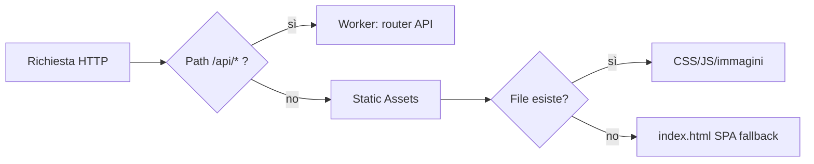

# Piano: web app catering (React + Vite + Cloudflare)

Documento di **solo pianificazione**. Nessun codice applicativo finché non approvato.

---

## 0. Nome di lavoro e stack

| Livello | Scelta |
|--------|--------|
| Nome progetto (proposta) | `convivio-catering` (sostituibile) |
| Frontend | React 19 + TypeScript + Vite |
| Routing | React Router 7 |
| Stili | CSS modulare + custom properties (niente UI kit “card grid”) |
| Validazione condivisa | Zod (form prenotazione + payload API) |
| Backend nello stesso repo | Worker TypeScript su `/api/*` |
| Persistenza mock (server) | **Cloudflare D1** con seed SQL (mock nei dati, non nell’architettura) |
| Deploy | **Un solo Worker** con Static Assets |

---

## 1. Scelta deploy: Workers + Static Assets (consigliato) vs Pages + Functions

### Raccomandazione: **Workers + Static Assets + entrypoint Worker unico**

Motivi rispetto a **Pages + `functions/`**:

1. **Un deployment, un artefatto** — `wrangler deploy` carica Worker + `dist/` insieme ([Static Assets](https://developers.cloudflare.com/workers/static-assets/)).
2. **SPA esplicita** — `assets.not_found_handling: "single-page-application"` per `/admin`, `/prenota`, ecc., senza dipendere da euristiche Pages.
3. **API prima degli asset solo dove serve** — `run_worker_first: ["/api/*"]` così le route API non vengono “inghiottite” dagli asset statici.
4. **Plugin Vite ufficiale** — dev locale con runtime `workerd` e stesso modello in prod ([Vite plugin](https://developers.cloudflare.com/workers/vite-plugin/)); la matrice Cloudflare segnala il plugin **non** su Pages.
5. **Percorso verso D1 / KV / R2** — binding nativi sullo stesso Worker; Pages Functions ha binding simili ma due mentalità (Pages vs Worker).
6. **Allineamento alla doc Cloudflare** — migrazione Pages → Workers come direzione della piattaforma ([migrate from Pages](https://developers.cloudflare.com/workers/static-assets/migration-guides/migrate-from-pages/)).

### Pages resta valido se…

Vuoi solo hosting statico + funzioni file-based senza Worker `main`. Per **frontend Vite + API coerente + D1 + CI unificato**, Workers è più pulito.

### Routing target (concettuale)



**`wrangler.jsonc` (schema concettuale, da validare in implementazione):**

- `name`: da secret `CLOUDFLARE_PROJECT_NAME` in CI (override) o valore default nel file
- `main`: `worker/index.ts`
- `compatibility_date`: data corrente (es. `2026-11-24`)
- `assets.directory`: `dist`
- `assets.not_found_handling`: `single-page-application`
- `assets.binding`: `ASSETS`
- `assets.run_worker_first`: `["/api/*"]`
- `d1_databases`: binding `DB` → database D1 catering

Handler Worker (logica):

- `pathname.startsWith("/api/")` → Hono (o router minimale) + JSON
- altrimenti → `env.ASSETS.fetch(request)` (con fallback SPA già gestito da Wrangler quando il Worker non risponde)

---

## 2. Direzione visiva e layout (anti “AI slop”)

### Mood

**Editoriale conviviale**: caldo, rilassato, da rivista food / supper club — non SaaS con 6 card identiche.

### Tipografia

- **Display**: serif con carattere (es. *Fraunces*, *Libre Baskerville*, o *Instrument Serif*)
- **Corpo/UI**: sans leggibile ma non generica (*Source Sans 3*, *DM Sans*)
- Scala tipo: hero `clamp(2.5rem, 5vw, 4.5rem)`, corpo 1.05–1.125rem, line-height generoso (1.6–1.75)

### Palette (esempio)

- Sfondo: crema `#F7F3ED`, carta `#FFFDF9`
- Testo: carbone caldo `#2C2825`
- Accento: terracotta `#C45C3E`, oliva `#5C6B4A`
- Evitare: gradienti viola/blu, glassmorphism, ombre `box-shadow` ripetute su ogni blocco

### Layout landing (`/`)

Struttura **asimmetrica a blocchi**, non griglia 3×N di card:

| Blocco | Contenuto | Layout |
|--------|-----------|--------|
| **Hero** | Titolo forte + sottotitolo filosofia + CTA primaria | 60/40 o testo su immagine con molto whitespace |
| **Filosofia** | 2–3 paragrafi corti, citazione pull-quote | Colonna stretta + margine largo; niente icon-set |
| **Come funziona** | 3 passi numerati in **timeline verticale** o lista tipografica | Non tre card uguali affiancate |
| **Anteprima menù** | Un pacchetto in evidenza + link “vedi tutti in prenotazione” | Blocco editoriale, non carousel di card |
| **CTA finale** | “Prenota il tuo catering” | Full-width band terracotta soft |

**CTA primaria**: testo fisso **「Prenota il tuo catering」** → `navigate('/prenota')`.

**Header minimale**: logo/wordmark, link ancorati leggeri, CTA secondaria ripetuta solo su mobile (sticky bottom bar opzionale, non obbligatoria).

### Vista prenotazione vs landing

- Route `/prenota/*`: sfondo più neutro, progressione step, meno “storytelling”
- Transizione visiva netta (cambio sfondo / assenza hero) così l’utente sente di essere nel flusso

### Cosa non fare

- Badge “Popular”, stelle finte, icone Lucide ovunque
- Sezioni `Features` / `Testimonials` / `Pricing` clonate
- Griglie responsive simmetriche con bordi 1px + `rounded-xl` omogenei

---

## 3. Flusso prenotazione (`/prenota`)

### Routing step (wizard)

| Step | Path | Scopo |
|------|------|--------|
| 1 | `/prenota` o `/prenota/pacchetto` | Scelta pacchetto |
| 2 | `/prenota/dettagli` | Ospiti + allergie |
| 3 | `/prenota/piatti` | Sostituzioni vincolate |
| 4 | `/prenota/pagamento` | Mock pagamento + riepilogo |
| 5 | `/prenota/conferma` | Codice ordine + stato |

Stato wizard: **React Context** `BookingDraftContext` (o Zustand leggero) con persistenza sessione opzionale `sessionStorage` (refresh non perde bozza fino al submit).

### Tre pacchetti (nomi coerenti col mood)

| ID | Nome | Posizionamento | Prezzo base (per persona, mock) |
|----|------|----------------|--------------------------------|
| `terra` | **Terra** | Radici, stagionale, essenziale | es. €32/ospite |
| `convivio` | **Convivio** | Firma dello chef, equilibrato | es. €48/ospite |
| `festa` | **Festa** | Premium, dessert + extra | es. €68/ospite |

Ogni pacchetto espone un **menù fisso** (antipasto, primo, secondo, contorno, dessert) con ID piatti stabili.

### Campi utente

1. **Ospiti**: numero intero, min 8 / max 120 (regole configurabili in shared constants)
2. **Allergie/intolleranze**:
   - chip rapide: glutine, lattosio, uova, frutta a guscio, vegano (multi-select)
   - textarea note libere
3. **Sostituzioni** (solo dove il piatto lo consente):
   - Per ogni piatto “sostituibile”: dropdown **solo** opzioni predefinite (nessun testo libero)
   - Esempio: primo default “Risotto allo zafferano” → alternative fisse `["Risotto radicchio", "Pasta ceci e rosmarino"]`

Validazione Zod lato client; stesso schema riusato dall’API su `POST /api/orders`.

### Mock pagamento

- Riepilogo dinamico: `totale = prezzoPerPersona(pacchetto) × ospiti` (+ eventuali supplementi futuri, flag disabilitati in v1)
- Metodi mock: radio “Carta”, “Bonifico”, “Contanti all’evento” (nessuna chiamata PSP)
- Submit → `POST /api/orders` → risposta `{ orderCode, status: "confirmed", createdAt }`
- `orderCode`: generato **lato server** con `crypto.randomUUID()` troncato/formattato (es. `CV-2026-A1B2C3`)

---

## 4. Admin (`/admin`)

### Accesso

- UI: gate semplice “password admin” (non produzione-ready, sufficiente per mock)
- API: header `Authorization: Bearer <ADMIN_TOKEN>` dove `ADMIN_TOKEN` è **Wrangler secret** / GitHub secret su deploy
- Route API protette: `/api/admin/*`

### Funzioni

| Vista | Azioni |
|-------|--------|
| **Ordini** | Tabella/lista editoriale: data, codice, pacchetto, ospiti, totale, allergie, sostituzioni, stato |
| **Menù** | CRUD piatti per pacchetto (titolo, descrizione, categoria, `substitutable`, ordine visualizzazione) |
| **Sostituzioni** | Per piatto sostituibile: elenco alternative (aggiungi/rimuovi/riordina) |

Nessuna riscrittura UI quando passi da D1 mock a “DB reale”: stessi endpoint, stesso contratto TypeScript.

---

## 5. Architettura dati (separazione UI / dominio)

### Principio: porte e adapter

```
UI (React)  →  ApiClient (fetch)  →  HTTP /api/*
Worker       →  Services           →  Repositories (interface)
                                      →  D1Repository (v1)
                                      →  (futuro) SupabaseRepository
```

Il frontend **non** importa mai SQL o storage; solo tipi da `shared/` e metodi `api.*`.

### Struttura cartelle

```
convivio-catering/
├── .github/workflows/
│   ├── ci.yml
│   └── deploy.yml
├── migrations/                 # D1 SQL
│   └── 0001_init.sql
├── public/
│   └── … immagini hero (opzionale)
├── shared/
│   ├── types/                  # Package, Dish, Order, SubstitutionOption
│   ├── schemas/                # Zod: CreateOrder, AdminDishUpdate
│   └── constants/              # allergeni, limiti ospiti
├── src/                        # Frontend Vite
│   ├── main.tsx
│   ├── app/
│   │   ├── router.tsx
│   │   └── providers.tsx
│   ├── pages/
│   │   ├── LandingPage.tsx
│   │   ├── booking/            # step components
│   │   └── admin/
│   ├── components/             # layout, typography, form primitives
│   ├── features/
│   │   ├── booking/
│   │   └── admin/
│   ├── lib/
│   │   └── api-client.ts       # wrapper fetch, tipizzato
│   └── styles/
│       ├── tokens.css
│       └── global.css
├── worker/
│   ├── index.ts                # fetch + ASSETS fallback
│   ├── env.ts                    # tipo Env da wrangler types
│   ├── router.ts                 # Hono app /api
│   ├── middleware/
│   │   └── admin-auth.ts
│   ├── repositories/
│   │   ├── menu-repository.ts    # interface
│   │   └── d1-menu-repository.ts
│   ├── services/
│   │   ├── menu-service.ts
│   │   └── order-service.ts
│   └── seed.ts                   # opzionale: seed su primo deploy / script
├── wrangler.jsonc
├── vite.config.ts
├── package.json
├── tsconfig.json
├── tsconfig.app.json
├── tsconfig.worker.json
└── eslint.config.js
```

### Modelli dominio (TypeScript, concettuali)

- `CateringPackage`: id, name, slug, pricePerGuestCents, description
- `Dish`: id, packageId, course (`antipasto|primo|…`), name, description, sortOrder, substitutable
- `SubstitutionOption`: id, dishId, label, sortOrder
- `Order`: id, orderCode, packageId, guestCount, allergies (JSON), notes, substitutions (JSON map dishId→optionId), paymentMethod, totalCents, status, createdAt

### API pubbliche (v1 mock)

| Metodo | Path | Note |
|--------|------|------|
| GET | `/api/packages` | 3 pacchetti + piatti annidati |
| GET | `/api/packages/:id/substitutions` | opzioni per piatti sostituibili |
| POST | `/api/orders` | crea ordine, calcola totale server-side |
| GET | `/api/orders/:code` | conferma (opzionale) |
| GET | `/api/admin/orders` | auth |
| PATCH | `/api/admin/dishes/:id` | auth |
| PUT | `/api/admin/dishes/:id/substitutions` | auth |

Calcolo prezzo **sempre server-side** (anti-manomissione client).

### Stato globale frontend

| Ambito | Meccanismo |
|--------|------------|
| Wizard prenotazione | `BookingDraftContext` |
| Dati server (menù) | React Query oppure `useEffect` + stato locale (v1: **TanStack Query** consigliato per cache/refetch admin) |
| Admin | fetch autenticato; invalidazione query dopo save |

Evitare Redux: scope troppo piccolo.

### Dipendenze da installare

**Runtime / build**

- `react`, `react-dom`, `react-router-dom`
- `vite`, `@vitejs/plugin-react`
- `@cloudflare/vite-plugin`, `wrangler`, `hono` (router Worker leggero)
- `zod`
- `@tanstack/react-query` (consigliato)

**Dev quality**

- `typescript`, `@types/react`, `@types/react-dom`
- `eslint`, `@eslint/js`, `typescript-eslint`, `eslint-plugin-react-hooks`
- `prettier` (opzionale)

**Nessun** MUI, Chakra, shadcn full kit (rischio template AI).

---

## 6. GitHub Actions e Cloudflare

### Secrets GitHub richiesti

| Secret | Uso |
|--------|-----|
| `CLOUDFLARE_ACCOUNT_ID` | Account ID |
| `CLOUDFLARE_API_TOKEN` | Auth Wrangler in CI |
| `CLOUDFLARE_PROJECT_NAME` | Nome Worker (= `name` in deploy) |
| `ADMIN_TOKEN` | Secret Worker + verifica admin (non in repo) |

Opzionale locale: `.dev.vars` con `ADMIN_TOKEN=...` (gitignored).

### Permessi API token (minimo consigliato)

Template dashboard: **Edit Cloudflare Workers** ([GitHub Actions](https://developers.cloudflare.com/workers/ci-cd/external-cicd/github-actions/)), scope **solo account** del progetto.

Aggiungi esplicitamente se usi D1 in v1:

| Permission | Motivo |
|------------|--------|
| **Account** → Workers Scripts → Edit | Deploy Worker |
| **Account** → Workers Scripts → Read | Deploy / dry-run |
| **Account** → D1 → Edit | Creare DB / migrazioni in CI (se automatizzate) |
| **Account** → Account Settings → Read | `wrangler whoami` / sanity check |

Non serve **Cloudflare Pages** se non usi Pages.

### Workflow `ci.yml` (PR + push)

1. `checkout`
2. `npm ci`
3. `npm run lint`
4. `npm run typecheck` (app + worker)
5. `npm run build` (Vite → `dist/`)
6. (opzionale) `wrangler deploy --dry-run`

### Workflow `deploy.yml` (push `main`)

1. Stessi check di CI
2. **Idempotenza progetto Worker**: il primo `wrangler deploy` **crea** lo Worker se il nome non esiste; i successivi aggiornano. Niente step separato “create Pages project”.
3. Step opzionale robusto:

```bash
# concettuale: fallisce soft se già esiste
wrangler d1 create "${D1_NAME}" 2>/dev/null || true
wrangler deploy --name "${CLOUDFLARE_PROJECT_NAME}"
```

4. Action ufficiale `cloudflare/wrangler-action@v4` con `apiToken`, `accountId`, `command: deploy`

**Nota**: `CLOUDFLARE_PROJECT_NAME` può essere passato come env che Wrangler legge tramite sostituzione nel workflow sul file config o `--name` esplicito.

### Script npm previsti

- `dev`: Vite + plugin Cloudflare (full stack locale)
- `build`: solo client → `dist/`
- `deploy`: `build` + `wrangler deploy`
- `lint`, `typecheck`, `db:migrate:local`, `db:migrate:remote`

---

## 7. Passaggi di verifica prima dell’implementazione

| # | Verifica | Criterio di successo |
|---|----------|----------------------|
| 1 | `npm run dev` | Landing + `/prenota` + `/admin` caricano |
| 2 | Deep link | Refresh su `/admin` e `/prenota/dettagli` → 200 SPA (non 404) |
| 3 | API | `GET /api/packages` restituisce 3 menù coerenti col seed |
| 4 | Sostituzioni | UI mostra solo opzioni admin; submit rifiutato se opzione non valida |
| 5 | Ordine | POST crea riga D1; conferma mostra codice univoco |
| 6 | Admin | Lista ordini riflette ultimo submit; edit piatto visibile in flusso prenotazione dopo refetch |
| 7 | Auth admin | API admin senza token → 401 |
| 8 | CI locale | `lint` + `typecheck` + `build` verdi |
| 9 | Deploy preview | `wrangler deploy` su account test; stessi check su URL `*.workers.dev` |

---

## 8. Fasi di implementazione (ordine suggerito)

1. **Scaffold** — Vite React TS + Wrangler + plugin Cloudflare + Hono + router SPA
2. **Shared types + Zod + seed D1** — dati realistici catering italiano
3. **API** — packages, orders, admin CRUD
4. **Landing editoriale** — tokens, tipografia, CTA
5. **Wizard prenotazione** — 5 step + pricing live da API
6. **Admin** — ordini + editor menù/sostituzioni
7. **CI/CD** — workflow + documentazione secrets nel README
8. **Pass finale anti-slop** — revisione UI (rimuovere pattern simmetrici residui)

---

## 9. Evoluzione futura (senza rifattorizzare UI)

| Cambio | Impatto |
|--------|---------|
| D1 → Supabase | Nuovo `Supabase*Repository` nel Worker; stessi service |
| Pagamento reale (Stripe) | Nuovo `PaymentGateway` interface; step pagamento chiama API |
| Email conferma | Worker + Resend; hook post-`createOrder` |
| Auth admin vera | Cloudflare Access su `/admin` o sessioni |

---

## 10. Decisioni aperte

1. **Nome definitivo** del progetto / Worker (`CLOUDFLARE_PROJECT_NAME`).
2. **TanStack Query**: sì (consigliato) o fetch minimale senza dipendenza extra.
3. **Immagini**: foto stock proprie / placeholder colore (per landing).
4. **Lingua copy**: solo italiano o IT + EN.
5. **Minimo ospiti** (proposta: 8) e massimo (proposta: 120).

---

*Generato in fase PLAN — aggiornare prima di passare all’implementazione.*